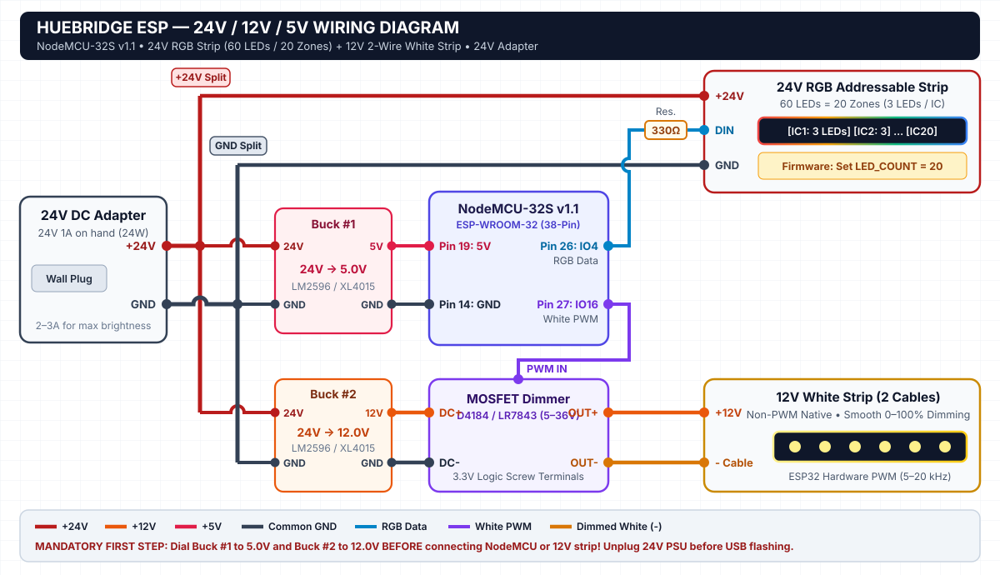

# HueBridge ESP

A complete **ESP32 Addressable LED Hue Translator + Home Server + Real Hue Bridge Proxy/Mirror** with a modern React management dashboard and PlatformIO firmware.

---

## Architecture

```text
  ┌──────────────────────────┐         ┌──────────────────────────────────┐
  │   Native Hue App /       │  HTTPS  │   Home Server (Node.js / TS)     │
  │   Hue Essentials / HA    │◄───────►│  • Hue v1 API + CLIP v2 + SSE    │
  └──────────────────────────┘  mDNS   │  • P-256 Hue TLS Certificate     │
                                SSDP   │  • SSDP + mDNS (_hue._tcp)       │
                                       │  • Web Management UI (:3000)     │
  ┌──────────────────────────┐  CLIPv2 │  • Real Hue Proxy + Mirror Sync  │
  │ Physical Philips Hue     │◄───────►│  • ESP32 WS / HTTP / UDP Bridge  │
  │ Bridge (Optional)        │   SSE   └────────────────┬─────────────────┘
  └──────────────────────────┘                          │
                                     WebSocket (/ws/esp32) + mDNS + UDP
                                                        │
                                       ┌────────────────▼─────────────────┐
                                       │   ESP32 / ESP32-S3 / ESP32-C3    │
                                       │  • NeoPixelBus Hardware RMT      │
                                       │  • WS2812B (RGB) & SK6812 (RGBW) │
                                       │  • Multi-segment Virtual Lights  │
                                       │  • Transitions, Gradients, FX    │
                                       └──────────────────────────────────┘
```

### Two Flexible Ways to Use With Your Physical Hue Bridge
1. **Emulated / Proxy Hue Bridge Mode (`Proxy + Mirror`)**:
   - The home server advertises itself as a Hue Bridge (`BSB002`) via mDNS (`_hue._tcp.local`) and SSDP, serves both Hue API v1 and CLIP v2 + `/eventstream/clip/v2` SSE over a P-256 Hue-compatible TLS cert, and exposes **both** your ESP32 LED segments **and** lights synced from your real Philips Hue Bridge.
2. **Real Hue Bridge Mirror Mode (`Mirror Only`)**:
   - Pair your physical Philips Hue Bridge in the **Real Hue Bridge** tab of the dashboard.
   - Keep using your official Hue App v5 directly with your physical Hue Bridge as usual, and bind any real Hue bulb or room to mirror its power, brightness, and color onto your ESP32 LED strips in real time via CLIP v2 SSE!

---

## Quick Start (Home Server)

### Option A: Docker Compose (Recommended for Linux / NAS Home Servers)

> **Important:** `network_mode: host` is required on Linux so mDNS (`224.0.0.251:5353`) and SSDP (`239.255.255.250:1900`) multicast packets reach your phone and ESP32 boards.

```bash
cp .env.example .env
docker compose up -d --build
```

Open the management dashboard at `http://<YOUR_SERVER_IP>:3000`.

### Option B: Direct Node.js (Windows, macOS, or Linux)

Requires **Node.js 20+**.

```bash
npm install
npm run build
npm start
```

> On Linux/macOS, binding ports `80` and `443` requires root or `CAP_NET_BIND_SERVICE` (`sudo setcap 'cap_net_bind_service=+ep' $(which node)`). For quick testing on non-privileged ports, override `HTTP_PORT=8080 HTTPS_PORT=8443 UI_PORT=3000`.

---

## Pairing With Hue Apps

1. Open the dashboard (`http://<SERVER_IP>:3000`).
2. Click the **Press Link** button on the **Overview** tab (opens a 30-second pairing window).
3. In **Hue Essentials**, **Home Assistant (Philips Hue integration)**, or the **Philips Hue app** (requires ports `80` and `443` on Linux/host IP):
   - Auto-discovery finds `HueBridge ESP` via `_hue._tcp.local` / SSDP, or enter the server IP manually.
4. *Note on official Hue App v5:* Recent versions of Signify's official iOS/Android app sometimes enforce cloud OAuth/account checks on emulated bridges. If your official v5 app refuses to pair with a local emulator, pair your physical Hue Bridge in **Real Hue Bridge** -> set **Mirror Only** mode and bind your Hue rooms/lights to your ESP32 strips!

---

## Flashing the ESP32 Firmware (`firmware/`)

1. Install **PlatformIO** (VS Code extension or `pio` CLI).
2. Copy `firmware/include/config.example.h` to `firmware/include/config.h` and fill in your Wi-Fi SSID/password.
   - Leave `SERVER_HOST` as `""` to auto-discover the home server via mDNS (`_hue-esp-srv._tcp.local`), or set your server's static IP.
3. Build & flash for your board:
   - NodeMCU-32S v1.1 (default): `pio run -d firmware -e nodemcu-32s -t upload`
   - Classic ESP32: `pio run -d firmware -e esp32dev -t upload`
   - ESP32-S3: `pio run -d firmware -e esp32-s3-devkitc-1 -t upload`
   - ESP32-C3: `pio run -d firmware -e esp32-c3-devkitm-1 -t upload`
4. Once online, open the **ESP32 Strips** tab to configure GPIO pin, LED count, WS2812B vs SK6812 RGBW, color order, current limiter (mA), and split a single strip into multiple independent virtual Hue lights!

---

## Hardware Wiring Schema (`hardware/`)

See [`hardware/installation-schema.md`](hardware/installation-schema.md) for the full parts list, NodeMCU-32S v1.1 (`ESP-WROOM-32`) pinout, `24V / 12V / 5V` buck converter setup, and MOSFET PWM white-strip dimming notes.



---

## Development & Tests

```bash
npm run typecheck
npm run build
npm test
```

