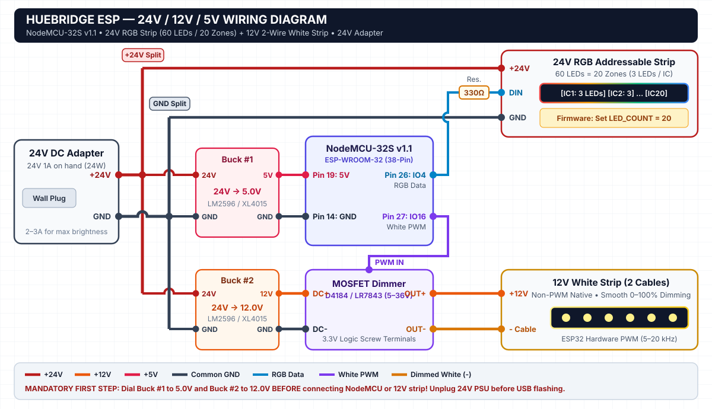

# HueBridge ESP — Installation Guide (`24V RGB + 12V White + NodeMCU-32S v1.1`)

Wiring schema tailored to your exact hardware:
- **NodeMCU-32S v1.1** (`ESP-WROOM-32`, 38-pin) — requires **`5V`** on Pin 19
- **24V Addressable RGB Strip** (`60 LEDs / 20 zones`, 3 LEDs per IC) — powered directly at **`24V`**
- **12V White-Only Strip** (`2 cables only: +12V and -`) — powered at **`12V`** and dimmed smoothly via MOSFET PWM
- **24V 1A Adapter (`24W`)** on hand

---

## Wiring Diagram

---

## What You Need to Add

Since you already have the **24V 1A adapter**, you do **not** need a separate 5V or 12V power brick—two small DC-DC buck converters step your `24V` down cleanly while keeping all grounds tied together:

| Qty | Part | Why |
| --- | --- | --- |
| **2** | **DC-DC Buck Converter (`LM2596` or `XL4015`)** | **Buck #1** steps `24V → 5.0V` (NodeMCU); **Buck #2** steps `24V → 12.0V` (White strip). *(Or 1× 4-channel `LM2596` fixed `5V + 12V` board.)* |
| **1** | **3.3V MOSFET PWM Module (`D4184` or `LR7843`)** | Rated `5V–36V`; dims your `12V` 2-wire white strip smoothly from `0%–100%` via `IO16`. |
| **1** | **`330Ω` Resistor** | Protects the `24V` RGB strip `DIN` signal line from `IO4`. |
| **2** | **WAGO 221-415 Lever Connectors** *(5-port)* | Solderless splitters for the `+24V` and `Common GND` rails. |
| **1** | **DC Barrel Jack → Screw Terminal** | Adapts your `24V` adapter barrel plug (`5.5×2.1mm`) into screw terminals without cutting the cord. |
| **1 set** | **18 AWG Wire + Female-Male Dupont Jumpers** | `18 AWG` for power/strips; Dupont jumpers for NodeMCU pins. |

> [!WARNING]
> **Do NOT use `Mini560` buck converters here** — they top out around `20V` input and will burn out on a `24V` adapter. Use **`LM2596`** (max `40V` in) or **`XL4015`** (max `36V` in).  
> **Do NOT use `IRF520` MOSFET boards** — they need 10V gate drive and fail on 3.3V ESP32 pins. Stick to **`D4184`** or **`LR7843`**.

---

## Mandatory First Step: Set Voltages Before Wiring Strips/NodeMCU

Before connecting the NodeMCU or the 12V White strip:
1. Wire **only** the `24V` adapter into `Buck #1 IN+/IN-` and `Buck #2 IN+/IN-`.
2. Turn the tiny brass potentiometer screw on:
   - **Buck #1** until its output reads **`5.0V`**
   - **Buck #2** until its output reads **`12.0V`**
   *(Tip: Buy the `XL4015` version with a built-in digital voltage screen—or the `LM2596` 4-channel fixed `3.3V / 5V / 12V` board—if you don't own a multimeter!)*
3. Unplug the `24V` adapter, finish wiring everything else, double-check polarity, then power on.

---

## NodeMCU-32S v1.1 Connections (USB Port Facing Bottom)

| Board Pin # | Silkscreen Label | Side | Connect To |
| --- | --- | --- | --- |
| **Pin 19** | **`5V`** | Bottom-Left | **Buck #1 `OUT+` (`5.0V`)** |
| **Pin 14** *(or Pin 32 / 38)* | **`GND`** | Left *(or Right)* | **Buck #1 `OUT-` (`GND`)** *(ties to Common `GND`)* |
| **Pin 26** | **`IO4`** | Right | **`330Ω` resistor** → **24V RGB Strip `DIN`** |
| **Pin 27** | **`IO16`** *(right above `IO4`)* | Right | **`D4184` / `LR7843` MOSFET `PWM IN`** |

### Remaining Connections
- **24V RGB Strip (`60 LEDs / 20 Zones`)**: `+24V` → `+24V` WAGO, `GND` → `Common GND` WAGO, `DIN` → `330Ω` from `IO4`.
- **MOSFET Module (`D4184` / `LR7843`)**: `DC+` → **Buck #2 `OUT+` (`12.0V`)**, `DC-` → **Buck #2 `OUT-` (`GND`)**, `OUT+` → **12V White Strip `+12V`**, `OUT-` → **12V White Strip `-`**.

---

## Power Budget Check: Your `24V 1A (24W)` Adapter

| Load | Typical Full-Brightness Power | Notes on `24V 1A (24W)` |
| --- | --- | --- |
| **NodeMCU-32S** | ~1.5W | Negligible (~0.07A drawn from `24V`) |
| **24V RGB Strip (60 LEDs)** | ~12W–18W *(all channels 100% white)*; ~4W–8W *(single color / dimmed)* | Safe alone on `1A` |
| **12V White Strip (2-Wire)** | Typically ~5W–12W per meter *(check strip wattage/m)* | Safe at moderate dimming |
| **Combined Peak** | Could exceed `24W` if **both** strips are pushed to 100% white at once | If the adapter gets hot or lights blink/reset at 100%, upgrade to **`24V 2A–3A` (48W–72W)** — no rewiring needed! |

- Remember to set **`LED_COUNT = 20`** in `firmware/include/config.h` and in the **ESP32 Strips** dashboard tab so the 20 IC zones map 1:1.
- Always **unplug the 24V adapter** (or disconnect Pin 19 `5V`) before plugging micro-USB into your PC for flashing.

---

<strong>Optional Upgrades (Long Wires / Extra Safety)</strong>

1. **Long RGB Data Wire (`> 30 cm`)**: If the 24V RGB strip flickers or shows wrong colors, add a **`74AHCT125`** level shifter powered from **Buck #1 (`5.0V`)** between `IO4` and the `330Ω` resistor.
2. **Inrush Capacitor**: Add a `1000µF 35V` capacitor across `+24V` and `GND` near the RGB strip start.
3. **USB Backfeed Protection**: Add a `1N5819` Schottky diode inline between Buck #1 `5.0V` and NodeMCU Pin 19 (`5V`) *(note: drops `5.0V` to ~`4.7V`, which works well for the onboard 3.3V regulator)*.

